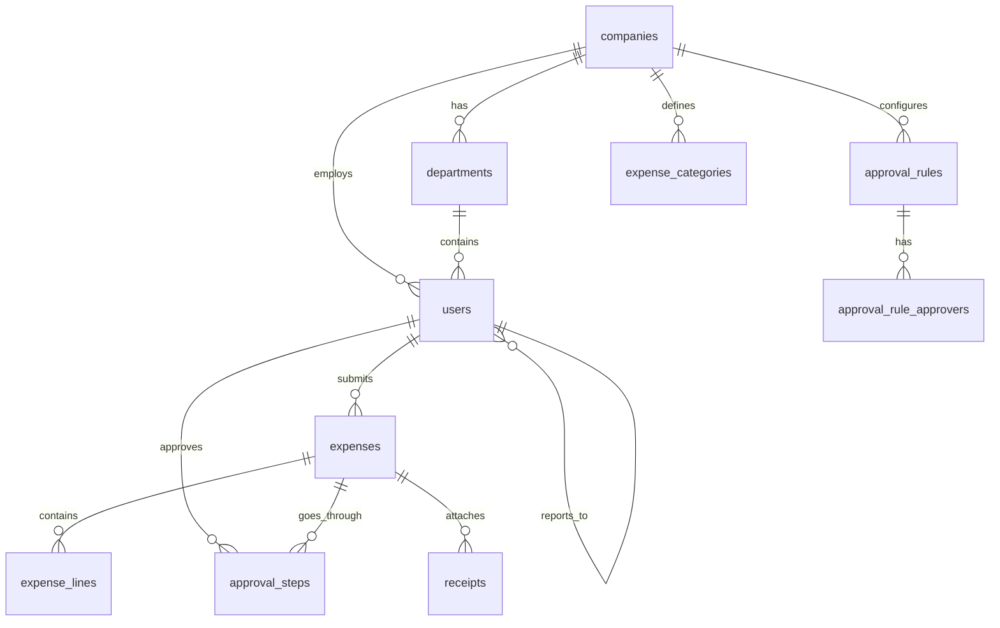
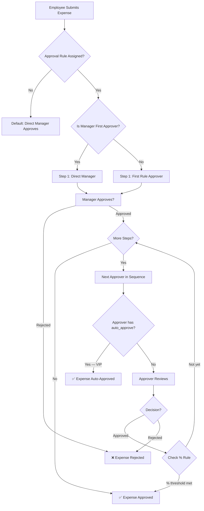
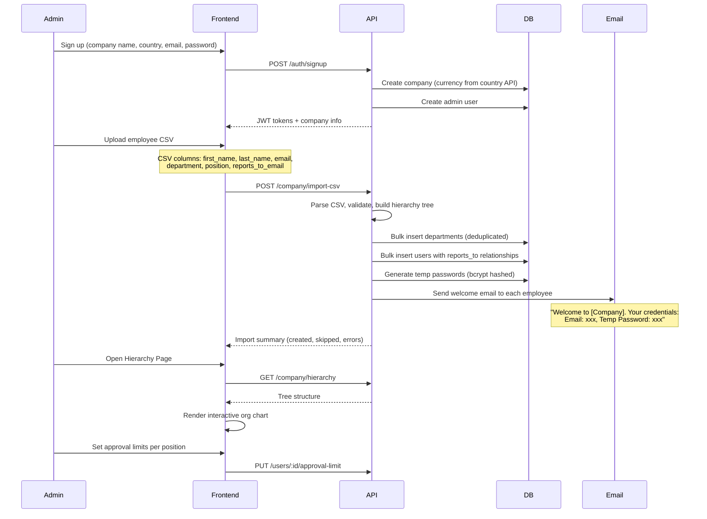
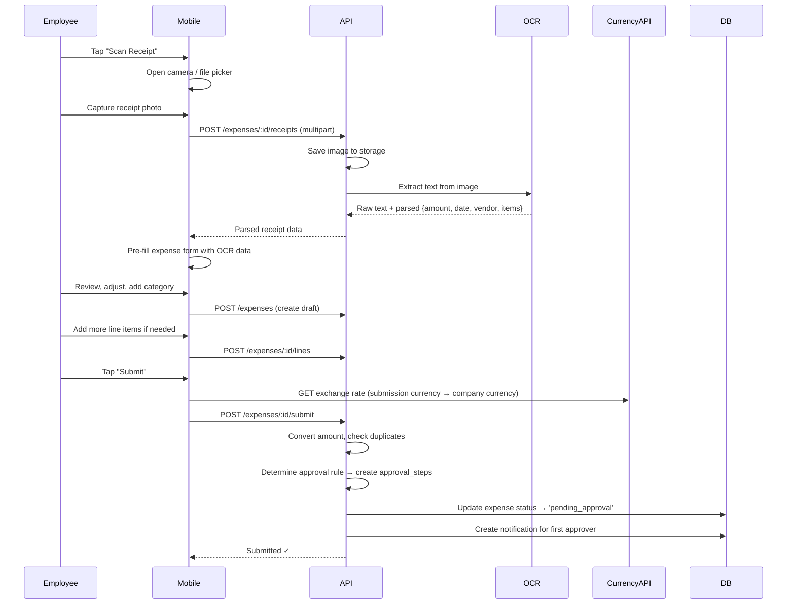
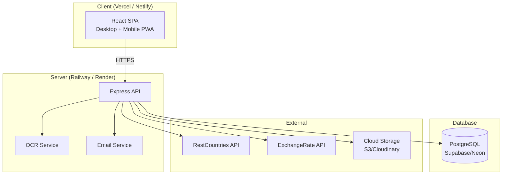

# Reimbursement Management System — Full Architecture & Design

## 1. Project Overview

Build a **Reimbursement Management System** for the Odoo hackathon. Companies can onboard via CSV import, define department hierarchies and approval thresholds, and employees can submit expenses (with OCR receipt scanning) through a mobile-friendly interface. Managers approve/reject through a hierarchical, department-scoped workflow with conditional approval rules.

### Two Surfaces

| Surface | Target | Tech | Purpose |
|---------|--------|------|---------|
| **Website** (Desktop) | Admin / Finance | React SPA (full-width) | Company setup, CSV import, hierarchy config, approval rules, analytics dashboard |
| **Mobile Web App** (PWA) | Employees / Managers | React SPA (responsive, mobile-first) | Expense submission, receipt scanning, approval queue, status tracking |

Both surfaces share the **same backend API** and **same codebase** — they are route-separated within one React app with responsive layouts.

---

## 2. Tech Stack

| Layer | Technology | Rationale |
|-------|-----------|-----------|
| **Frontend** | React 18 + Vite | Fast dev, component-based, single codebase for both surfaces |
| **Routing** | React Router v6 | Nested layouts for desktop vs mobile views |
| **State** | Zustand | Lightweight, no boilerplate |
| **Styling** | Vanilla CSS + CSS Variables | Per hackathon guidelines — no Tailwind unless requested |
| **Backend** | Node.js + Express | JavaScript end-to-end, fast to build |
| **ORM** | Prisma | Type-safe PostgreSQL queries, auto-migrations |
| **Database** | PostgreSQL | Required by problem statement. Relational for hierarchies & approval chains |
| **Auth** | JWT (access + refresh tokens) | Stateless, scalable |
| **OCR** | Tesseract.js (or Google Vision API) | Receipt text extraction |
| **File Storage** | Local disk (dev) / S3 (prod) | Receipt image uploads |
| **Email** | Nodemailer + Gmail SMTP | Credential notifications, approval alerts |
| **External APIs** | restcountries.com, exchangerate-api.com | Currency list & live conversion rates |

---

## 3. Database Schema (PostgreSQL)



### 3.1 Table Definitions

#### `companies`
| Column | Type | Notes |
|--------|------|-------|
| id | UUID PK | |
| name | VARCHAR(255) | Company name |
| country_code | VARCHAR(3) | ISO country code |
| base_currency | VARCHAR(3) | e.g. "INR", "USD" — set from country on signup |
| logo_url | TEXT | Optional |
| created_at | TIMESTAMP | |

#### `departments`
| Column | Type | Notes |
|--------|------|-------|
| id | UUID PK | |
| company_id | UUID FK → companies | |
| name | VARCHAR(255) | e.g. "Engineering", "Finance" |
| parent_dept_id | UUID FK → departments | Nullable — for nested dept hierarchy |
| created_at | TIMESTAMP | |

#### `users`
| Column | Type | Notes |
|--------|------|-------|
| id | UUID PK | |
| company_id | UUID FK → companies | |
| department_id | UUID FK → departments | |
| email | VARCHAR(255) UNIQUE | Organisation email |
| password_hash | VARCHAR(255) | bcrypt |
| first_name | VARCHAR(100) | |
| last_name | VARCHAR(100) | |
| role | ENUM('admin','manager','employee') | |
| position | VARCHAR(100) | e.g. "Team Lead", "Director" — from CSV |
| reports_to | UUID FK → users | Nullable — direct manager |
| approval_limit | DECIMAL(12,2) | Max amount this person can approve without escalation |
| is_active | BOOLEAN | Default true |
| created_at | TIMESTAMP | |

> [!IMPORTANT]
> `reports_to` enforces **department-scoped hierarchy**: an employee always reports to someone in the same department (or department head reports to company-level manager). This is validated on CSV import.

#### `expense_categories`
| Column | Type | Notes |
|--------|------|-------|
| id | UUID PK | |
| company_id | UUID FK → companies | |
| name | VARCHAR(100) | e.g. "Travel", "Food", "Office Supplies" |
| is_active | BOOLEAN | |

#### `expenses`
| Column | Type | Notes |
|--------|------|-------|
| id | UUID PK | |
| company_id | UUID FK → companies | |
| submitted_by | UUID FK → users | Employee who submitted |
| title | VARCHAR(255) | Short description |
| total_amount | DECIMAL(12,2) | In submission currency |
| submission_currency | VARCHAR(3) | Currency employee submitted in |
| converted_amount | DECIMAL(12,2) | Auto-converted to company base_currency |
| exchange_rate | DECIMAL(12,6) | Rate used at submission time |
| status | ENUM('draft','submitted','pending_approval','approved','rejected','escalated') | |
| current_approval_step | INTEGER | Which step in the sequence is active |
| submitted_at | TIMESTAMP | |
| resolved_at | TIMESTAMP | Nullable |
| created_at | TIMESTAMP | |

#### `expense_lines`
| Column | Type | Notes |
|--------|------|-------|
| id | UUID PK | |
| expense_id | UUID FK → expenses | |
| category_id | UUID FK → expense_categories | |
| description | TEXT | e.g. "Dinner at Hotel Taj" |
| amount | DECIMAL(12,2) | Line-item amount |
| expense_date | DATE | When expense occurred |
| vendor_name | VARCHAR(255) | Restaurant/vendor name (from OCR or manual) |
| created_at | TIMESTAMP | |

#### `receipts`
| Column | Type | Notes |
|--------|------|-------|
| id | UUID PK | |
| expense_id | UUID FK → expenses | |
| file_url | TEXT | Path to uploaded image |
| ocr_raw_text | TEXT | Raw OCR output |
| ocr_parsed_data | JSONB | Structured: {amount, date, vendor, items[]} |
| created_at | TIMESTAMP | |

#### `approval_rules`
| Column | Type | Notes |
|--------|------|-------|
| id | UUID PK | |
| company_id | UUID FK → companies | |
| name | VARCHAR(255) | e.g. "Miscellaneous Expense Rule" |
| description | TEXT | |
| is_manager_first_approver | BOOLEAN | If true, direct manager is always Step 1 |
| min_approval_percentage | INTEGER | e.g. 60 — % of approvers needed. NULL = all must approve |
| is_active | BOOLEAN | |
| created_at | TIMESTAMP | |

#### `approval_rule_approvers`
| Column | Type | Notes |
|--------|------|-------|
| id | UUID PK | |
| rule_id | UUID FK → approval_rules | |
| approver_id | UUID FK → users | |
| step_order | INTEGER | Sequence: 1, 2, 3... |
| can_auto_approve | BOOLEAN | If true, this person's single approval = full approval (VIP override, e.g. CFO) |
| is_required | BOOLEAN | Must this specific person approve? |

#### `approval_steps` (Instance log per expense)
| Column | Type | Notes |
|--------|------|-------|
| id | UUID PK | |
| expense_id | UUID FK → expenses | |
| approver_id | UUID FK → users | |
| step_order | INTEGER | |
| status | ENUM('pending','approved','rejected','skipped') | |
| comments | TEXT | Approver's notes |
| decided_at | TIMESTAMP | |
| created_at | TIMESTAMP | |

#### `notifications`
| Column | Type | Notes |
|--------|------|-------|
| id | UUID PK | |
| user_id | UUID FK → users | Recipient |
| type | ENUM('approval_request','approval_decision','credential','system') | |
| title | VARCHAR(255) | |
| message | TEXT | |
| is_read | BOOLEAN | |
| reference_id | UUID | Points to expense_id or other entity |
| created_at | TIMESTAMP | |

#### `audit_log`
| Column | Type | Notes |
|--------|------|-------|
| id | UUID PK | |
| company_id | UUID FK → companies | |
| user_id | UUID FK → users | Who did it |
| action | VARCHAR(100) | e.g. "EXPENSE_SUBMITTED", "APPROVAL_GRANTED" |
| entity_type | VARCHAR(50) | e.g. "expense", "user" |
| entity_id | UUID | |
| metadata | JSONB | Extra context |
| created_at | TIMESTAMP | |

---

## 4. Approval Engine — Core Logic

This is the most complex subsystem. Here's how it works:

### 4.1 Flow Diagram



### 4.2 Key Rules

1. **Department-scoped**: Employees are approved by their **own** department hierarchy — not cross-department managers.
2. **Manager self-approval**: Managers **cannot** self-approve. Their expenses go to **their** `reports_to` (their own manager/department head).
3. **Approval limits**: If an expense exceeds a manager's `approval_limit`, it **auto-escalates** to the next level in hierarchy.
4. **Duplicate/split expense detection**: Before submission, system checks for expenses with the same date + similar amount from the same employee to flag potential duplicates.
5. **Percentage rule**: If `min_approval_percentage` is set (e.g. 60%), the system counts approvals across the entire approver set. Once 60% approve, the expense is approved even if later approvers haven't acted.
6. **VIP override**: If an approver with `can_auto_approve = true` (e.g. CFO) approves, the expense is immediately fully approved regardless of other pending steps.

---

## 5. Backend API Design (Express + Prisma)

### 5.1 Project Structure

```
server/
├── prisma/
│   └── schema.prisma
├── src/
│   ├── index.ts                  # Entry point
│   ├── config/
│   │   ├── database.ts
│   │   ├── env.ts
│   │   └── email.ts
│   ├── middleware/
│   │   ├── auth.ts               # JWT verification
│   │   ├── rbac.ts               # Role-based access guard
│   │   ├── validate.ts           # Zod request validation
│   │   ├── upload.ts             # Multer file upload
│   │   └── errorHandler.ts
│   ├── routes/
│   │   ├── auth.routes.ts
│   │   ├── company.routes.ts
│   │   ├── user.routes.ts
│   │   ├── expense.routes.ts
│   │   ├── approval.routes.ts
│   │   ├── category.routes.ts
│   │   ├── receipt.routes.ts
│   │   └── notification.routes.ts
│   ├── controllers/
│   │   └── (mirrors routes)
│   ├── services/
│   │   ├── auth.service.ts
│   │   ├── company.service.ts
│   │   ├── user.service.ts
│   │   ├── expense.service.ts
│   │   ├── approval.engine.ts    # ⭐ Core approval logic
│   │   ├── ocr.service.ts        # Receipt OCR pipeline
│   │   ├── currency.service.ts   # Exchange rate API calls
│   │   ├── csv-import.service.ts # Employee bulk import
│   │   ├── email.service.ts
│   │   └── notification.service.ts
│   ├── validators/
│   │   └── (Zod schemas per entity)
│   └── utils/
│       ├── jwt.ts
│       ├── password.ts
│       └── logger.ts
├── uploads/                      # Receipt images (dev)
├── package.json
└── tsconfig.json
```

### 5.2 API Endpoints

#### Auth
| Method | Endpoint | Role | Description |
|--------|----------|------|-------------|
| POST | `/api/auth/signup` | Public | Company signup → creates company + admin user |
| POST | `/api/auth/login` | Public | Returns JWT tokens |
| POST | `/api/auth/refresh` | Public | Refresh access token |
| POST | `/api/auth/forgot-password` | Public | Send reset email |

#### Company
| Method | Endpoint | Role | Description |
|--------|----------|------|-------------|
| GET | `/api/company` | Admin | Get company details |
| PUT | `/api/company` | Admin | Update company settings |
| POST | `/api/company/import-csv` | Admin | Upload employee CSV → bulk create users + hierarchy |
| GET | `/api/company/hierarchy` | Admin | Get org tree structure |
| GET | `/api/company/currencies` | Any | List available currencies (restcountries API) |

#### Users
| Method | Endpoint | Role | Description |
|--------|----------|------|-------------|
| GET | `/api/users` | Admin/Manager | List users (filtered by dept for managers) |
| POST | `/api/users` | Admin | Create single user |
| PUT | `/api/users/:id` | Admin | Update user (role, department, reports_to) |
| PUT | `/api/users/:id/approval-limit` | Admin | Set approval threshold |
| DELETE | `/api/users/:id` | Admin | Soft-delete (is_active = false) |

#### Departments
| Method | Endpoint | Role | Description |
|--------|----------|------|-------------|
| GET | `/api/departments` | Admin | List departments |
| POST | `/api/departments` | Admin | Create department |
| PUT | `/api/departments/:id` | Admin | Update department |

#### Expense Categories
| Method | Endpoint | Role | Description |
|--------|----------|------|-------------|
| GET | `/api/categories` | Any | List categories |
| POST | `/api/categories` | Admin | Create category |
| PUT | `/api/categories/:id` | Admin | Update category |

#### Expenses
| Method | Endpoint | Role | Description |
|--------|----------|------|-------------|
| GET | `/api/expenses` | Any | List (employee sees own, manager sees team's, admin sees all) |
| GET | `/api/expenses/:id` | Any | Expense detail + lines + receipts + approval trail |
| POST | `/api/expenses` | Employee | Create new expense (draft) |
| PUT | `/api/expenses/:id` | Employee | Update draft expense |
| POST | `/api/expenses/:id/submit` | Employee | Submit → triggers approval workflow |
| POST | `/api/expenses/:id/lines` | Employee | Add expense line items |
| DELETE | `/api/expenses/:id` | Employee | Delete draft only |

#### Receipts & OCR
| Method | Endpoint | Role | Description |
|--------|----------|------|-------------|
| POST | `/api/expenses/:id/receipts` | Employee | Upload receipt image |
| POST | `/api/receipts/:id/ocr` | Employee | Trigger OCR → returns parsed data |

#### Approvals
| Method | Endpoint | Role | Description |
|--------|----------|------|-------------|
| GET | `/api/approvals/pending` | Manager | Expenses waiting for my approval |
| POST | `/api/approvals/:expenseId/approve` | Manager | Approve with comments |
| POST | `/api/approvals/:expenseId/reject` | Manager | Reject with comments |

#### Approval Rules (Admin configuration)
| Method | Endpoint | Role | Description |
|--------|----------|------|-------------|
| GET | `/api/approval-rules` | Admin | List all rules |
| POST | `/api/approval-rules` | Admin | Create approval rule |
| PUT | `/api/approval-rules/:id` | Admin | Update rule (add/remove approvers, change %) |
| DELETE | `/api/approval-rules/:id` | Admin | Deactivate rule |

#### Notifications
| Method | Endpoint | Role | Description |
|--------|----------|------|-------------|
| GET | `/api/notifications` | Any | My notifications |
| PUT | `/api/notifications/:id/read` | Any | Mark as read |

---

## 6. Frontend Architecture (React + Vite)

### 6.1 Project Structure

```
client/
├── public/
│   ├── manifest.json           # PWA manifest
│   └── sw.js                   # Service worker for mobile
├── src/
│   ├── main.jsx
│   ├── App.jsx
│   ├── index.css               # Design system (CSS variables, base styles)
│   │
│   ├── api/
│   │   ├── client.js           # Axios instance with JWT interceptors
│   │   ├── auth.api.js
│   │   ├── expense.api.js
│   │   ├── approval.api.js
│   │   └── ... (per-resource)
│   │
│   ├── stores/
│   │   ├── authStore.js        # Zustand - user, tokens, role
│   │   ├── expenseStore.js
│   │   ├── approvalStore.js
│   │   └── notificationStore.js
│   │
│   ├── hooks/
│   │   ├── useAuth.js
│   │   ├── useCurrency.js
│   │   └── useMediaQuery.js    # Desktop vs mobile detection
│   │
│   ├── layouts/
│   │   ├── DesktopLayout.jsx   # Sidebar + header + content area (admin)
│   │   ├── MobileLayout.jsx    # Bottom nav + header (employee/manager)
│   │   └── AuthLayout.jsx      # Login/signup wrapper
│   │
│   ├── pages/
│   │   ├── auth/
│   │   │   ├── LoginPage.jsx
│   │   │   ├── SignupPage.jsx
│   │   │   └── ForgotPassword.jsx
│   │   │
│   │   ├── admin/              # Desktop website pages
│   │   │   ├── DashboardPage.jsx
│   │   │   ├── EmployeeManagement.jsx
│   │   │   ├── CSVImportPage.jsx
│   │   │   ├── HierarchyPage.jsx        # Visual org chart
│   │   │   ├── ApprovalRulesPage.jsx
│   │   │   ├── CategoryManagement.jsx
│   │   │   └── AllExpensesPage.jsx
│   │   │
│   │   ├── employee/           # Mobile-first pages
│   │   │   ├── MyExpenses.jsx
│   │   │   ├── NewExpense.jsx
│   │   │   ├── ExpenseDetail.jsx
│   │   │   └── ScanReceipt.jsx          # Camera → OCR flow
│   │   │
│   │   └── manager/            # Mobile-first pages
│   │       ├── ApprovalQueue.jsx
│   │       ├── ApprovalDetail.jsx
│   │       └── TeamExpenses.jsx
│   │
│   ├── components/
│   │   ├── common/
│   │   │   ├── Button.jsx
│   │   │   ├── Input.jsx
│   │   │   ├── Modal.jsx
│   │   │   ├── DataTable.jsx
│   │   │   ├── StatusBadge.jsx
│   │   │   ├── CurrencyDisplay.jsx
│   │   │   ├── FileUpload.jsx
│   │   │   └── LoadingSpinner.jsx
│   │   │
│   │   ├── expense/
│   │   │   ├── ExpenseCard.jsx          # Mobile card view
│   │   │   ├── ExpenseForm.jsx
│   │   │   ├── ExpenseLineItem.jsx
│   │   │   ├── ApprovalTimeline.jsx     # Visual step tracker
│   │   │   └── ReceiptViewer.jsx
│   │   │
│   │   ├── admin/
│   │   │   ├── OrgChart.jsx             # D3/react-org-chart
│   │   │   ├── CSVUploader.jsx
│   │   │   ├── ApprovalRuleBuilder.jsx  # Drag-and-drop rule editor
│   │   │   └── AnalyticsCards.jsx
│   │   │
│   │   └── layout/
│   │       ├── Sidebar.jsx
│   │       ├── BottomNavBar.jsx
│   │       ├── Header.jsx
│   │       └── NotificationBell.jsx
│   │
│   └── utils/
│       ├── formatCurrency.js
│       ├── dateHelpers.js
│       └── constants.js
│
├── vite.config.js
└── package.json
```

### 6.2 Routing Strategy

```jsx
<Routes>
  {/* Auth — shared */}
  <Route element={<AuthLayout />}>
    <Route path="/login" element={<LoginPage />} />
    <Route path="/signup" element={<SignupPage />} />
  </Route>

  {/* Admin — Desktop layout */}
  <Route element={<RequireAuth roles={['admin']} />}>
    <Route element={<DesktopLayout />}>
      <Route path="/admin/dashboard" element={<DashboardPage />} />
      <Route path="/admin/employees" element={<EmployeeManagement />} />
      <Route path="/admin/import" element={<CSVImportPage />} />
      <Route path="/admin/hierarchy" element={<HierarchyPage />} />
      <Route path="/admin/approval-rules" element={<ApprovalRulesPage />} />
      <Route path="/admin/categories" element={<CategoryManagement />} />
      <Route path="/admin/expenses" element={<AllExpensesPage />} />
    </Route>
  </Route>

  {/* Employee — Mobile layout */}
  <Route element={<RequireAuth roles={['employee']} />}>
    <Route element={<MobileLayout />}>
      <Route path="/expenses" element={<MyExpenses />} />
      <Route path="/expenses/new" element={<NewExpense />} />
      <Route path="/expenses/:id" element={<ExpenseDetail />} />
      <Route path="/scan" element={<ScanReceipt />} />
    </Route>
  </Route>

  {/* Manager — Mobile layout */}
  <Route element={<RequireAuth roles={['manager']} />}>
    <Route element={<MobileLayout />}>
      <Route path="/approvals" element={<ApprovalQueue />} />
      <Route path="/approvals/:id" element={<ApprovalDetail />} />
      <Route path="/team-expenses" element={<TeamExpenses />} />
    </Route>
  </Route>
</Routes>
```

### 6.3 Design System (CSS Variables)

```css
:root {
  /* Brand palette — deep navy / electric blue */
  --color-primary: #2563eb;
  --color-primary-light: #3b82f6;
  --color-primary-dark: #1d4ed8;
  --color-accent: #06b6d4;

  /* Status colors */
  --color-success: #10b981;
  --color-warning: #f59e0b;
  --color-danger: #ef4444;
  --color-info: #6366f1;

  /* Neutrals — dark mode first */
  --bg-primary: #0f172a;
  --bg-secondary: #1e293b;
  --bg-card: #1e293b;
  --bg-hover: #334155;
  --text-primary: #f1f5f9;
  --text-secondary: #94a3b8;
  --border-color: #334155;

  /* Typography */
  --font-family: 'Inter', -apple-system, sans-serif;
  --font-size-xs: 0.75rem;
  --font-size-sm: 0.875rem;
  --font-size-base: 1rem;
  --font-size-lg: 1.125rem;
  --font-size-xl: 1.25rem;
  --font-size-2xl: 1.5rem;

  /* Spacing */
  --space-1: 0.25rem;
  --space-2: 0.5rem;
  --space-3: 0.75rem;
  --space-4: 1rem;
  --space-6: 1.5rem;
  --space-8: 2rem;

  /* Shapes */
  --radius-sm: 6px;
  --radius-md: 10px;
  --radius-lg: 16px;
  --radius-full: 9999px;

  /* Shadows */
  --shadow-sm: 0 1px 2px rgba(0,0,0,0.3);
  --shadow-md: 0 4px 12px rgba(0,0,0,0.4);
  --shadow-lg: 0 10px 30px rgba(0,0,0,0.5);

  /* Transitions */
  --transition-fast: 150ms ease;
  --transition-normal: 250ms ease;
}
```

---

## 7. Key Workflows

### 7.1 Company Onboarding (CSV Import Flow)



### 7.2 Expense Submission + OCR



### 7.3 Duplicate / Split Expense Detection

When an employee submits:
1. Query: same `submitted_by` + same `expense_date` range (±1 day) + `total_amount` within 10% similarity
2. If match found → return **warning** (not blocking) with the similar expense IDs
3. Frontend shows: "⚠️ Similar expense found from [date]. Continue?"

---

## 8. Security & Access Control

### 8.1 RBAC Middleware

```
rbac('admin')              → only admin
rbac('admin', 'manager')   → admin or manager
rbac('*')                  → any authenticated user
```

### 8.2 Data Isolation Rules

| Role | Data Access |
|------|------------|
| Admin | All company data. Can override any approval. |
| Manager | Own team's expenses (users where `reports_to = manager.id`). Only expenses routed to them for approval. |
| Employee | Only their own expenses and notifications. |

### 8.3 Security Measures
- Passwords: bcrypt with cost factor 12
- JWT access token: 15 min expiry
- JWT refresh token: 7 day expiry (stored in httpOnly cookie)
- Rate limiting on auth endpoints: 5 requests/min
- Input validation: Zod schemas on every endpoint
- SQL injection: prevented by Prisma parameterized queries
- CORS: whitelist frontend origin only
- File upload: max 5MB, only image MIME types

---

## 9. External API Integration

### 9.1 Country / Currency API
- **Endpoint**: `https://restcountries.com/v3.1/all?fields=name,currencies`
- **Usage**: On company signup — dropdown of countries → auto-set base currency
- **Caching**: Cache the full list for 24h (it rarely changes)

### 9.2 Exchange Rate API
- **Endpoint**: `https://api.exchangerate-api.com/v4/latest/{BASE_CURRENCY}`
- **Usage**: When employee submits in a different currency → convert to company base currency
- **Caching**: Cache rates per base currency for 1h

---

## 10. Deployment Architecture



---

## User Review Required

> [!IMPORTANT]
> **Two-surface approach**: Both the admin website and employee/manager mobile app are in a **single React codebase**, separated by route groups and layouts. This avoids maintaining two repos while giving distinct UX per role. Is this approach acceptable, or do you want truly separate apps?

> [!IMPORTANT]
> **OCR engine**: I've planned **Tesseract.js** (free, runs server-side in Node) as the default. Google Cloud Vision API is more accurate but requires a GCP account + API key. Which do you prefer for the hackathon?

> [!WARNING]
> **PostgreSQL hosting**: The hackathon guidelines discourage "Backend-as-a-Service" like Supabase. I recommend using a **raw PostgreSQL instance** on Railway or Render (or local Docker) with Prisma as the ORM — this keeps us compliant while still being fast to develop. Confirm?

## Open Questions

1. **Email provider**: Do you have a Gmail account to use with Nodemailer SMTP, or should we mock the email sending for the hackathon demo?
2. **CSV format**: Do you have a sample CSV of employee data, or should I design the expected format?
3. **Receipt storage**: For the hackathon, is local disk storage for receipts fine, or do you need cloud storage (S3/Cloudinary)?
4. **Team size & split**: The `.AI/Tasks` has DevP, DevSK, DevSM, DevY — is that 4 developers? How should we split the work?

## Verification Plan

### Automated Tests
- Prisma migrations: `npx prisma migrate dev` to validate schema
- API routes: manual Postman/Thunder Client testing during dev
- Approval engine: unit tests for sequential, percentage, and VIP override flows

### Manual Verification
- CSV import → verify users appear in hierarchy
- OCR scan → verify parsed data pre-fills form
- Full expense lifecycle: submit → approve chain → final status update
- Mobile responsiveness: test on Chrome DevTools mobile viewport
- Currency conversion: submit expense in USD for INR-based company
